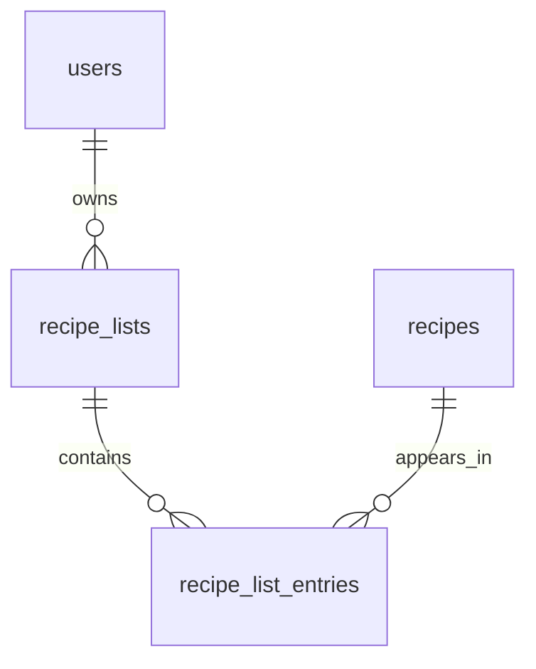

# Recipe lists — « listes de recettes »

Status: **design, then implementation** (this document is written first and updated in place where the implementation
proves a decision wrong). Companion documents: [recipes-domain-model.md](recipes-domain-model.md) (the model this
extends), [api-error-handling.md](api-error-handling.md) (the statuses, and the three new `409`s),
[service-controller-contract.md](service-controller-contract.md), [openapi.md](openapi.md),
[optional-authentication.md](optional-authentication.md), [testing-database.md](testing-database.md).

## What the feature is for

A member files recipes into lists they name — « Pour le dimanche », « Recettes de mamie », « À tester » — each with an
emoji that makes the tile recognisable at a glance. A list is a personal shelf: it is how a member comes back to the
handful of recipes they care about out of a library that only grows.

The feature is deliberately small and uniform:

- A list belongs to **one member** and is **private**: only its owner can see, change or use it. No other member, no
  visitor, **no admin bypass** — an administrator is a member like any other as far as someone else's list goes.
- There are **no favorites**, not even as a special list, and no other kind of list. Every list behaves the same way.
- A list has a name, an emoji, and a set of recipes. That is all (see [Planned evolutions](#planned-evolutions) for what
  is intentionally *not* here yet).

## Model



| Table                 | Columns                                                                                           |
|-----------------------|---------------------------------------------------------------------------------------------------|
| `recipe_lists`        | `id` UUID, `owner_id` FK → `users` (not null, immutable), `name`, `normalized_name`, `emoji`, `created_at`, `updated_at` |
| `recipe_list_entries` | `list_id` FK → `recipe_lists`, `recipe_id` FK → `recipes` (**composite PK**), `added_at`           |

Package layout follows [recipes-domain-model.md](recipes-domain-model.md#package-layout): everything is in the
`recipes` domain (`entities/recipes`, `repositories/recipes`, `services/recipes`, `controllers/recipes`,
`mappers/recipes`, `models/recipes`). No new domain package.

### `recipe_lists`

- **`owner_id`** is set by the service from `CurrentUserService`, not stamped by `@CreatedBy`. Ownership is the heart of
  this feature, and a column that decides who may read a row should be written by code that says so, not by an auditing
  side effect. `RecipeEntity.author` uses `@CreatedBy` for historical reasons; copying it here would make a missing
  security context a `NOT NULL` violation (a 500) instead of the `401` it is. It is `updatable = false`: a list never
  changes hands.
- **No `created_by` / `updated_by`.** The owner is the only person who can write the row, so both would hold the owner's
  id forever — the reasoning `RecipeEntity` documents for `author`. The entity therefore does not extend
  `AuditableEntity`; it carries `createdAt` and `updatedAt` through `@CreatedDate` / `@LastModifiedDate`.
- **`updated_at` changes when the list is renamed or its emoji changes — and only then.** Adding or removing a recipe
  does **not** touch it. Reasons: (1) `updatedAt` describes the list's own definition, while its content is already
  described by `recipeCount`, `coverMediaIds` and each entry's `added_at`; (2) adding a recipe that is already there
  must be "a success that changes nothing", which would be false if it bumped a timestamp; (3) it would make every add
  write the list row, serialising concurrent adds to one list on a row lock for no reader's benefit. A `PUT` that sends
  the values the list already has changes nothing either (Hibernate sees no dirty field, so the timestamp stays).
- **`name`** is required, trimmed, 1 to 100 characters, and stored as typed (trimmed). **`normalized_name`** is the same
  string through `ReferenceNameNormalizer` (trim, collapse whitespace, lowercase, strip accents) and carries the
  uniqueness — the reference-table pattern, see
  [recipes-domain-model.md](recipes-domain-model.md#why-a-normalized_name-column-instead-of-a-plain-unique-on-name).
  The constraint is `unique (owner_id, normalized_name)`, named `uk_recipe_lists_owner_normalized_name`: two members may
  both have « Desserts », one member may not have « Desserts » and « desserts ».
  - **`normalized_name` is `varchar(300)`, not 100.** Normalisation goes through NFD, which expands a Hangul syllable
    into up to three jamo, so a 100-character Korean name normalises to 300 characters. At 100 the insert would fail
    with `value too long` and surface as a 500 for a perfectly valid name. Three times the name limit is the worst case.
  - The unique constraint's index (`owner_id` leading) also serves "all the lists of one member".
- **`emoji`** is required, stored as text, `varchar(32)`, never as an image. The front proposes a default; the back
  requires a value. The exact rule is [below](#the-emoji-rule).

### `recipe_list_entries`

- The primary key `(list_id, recipe_id)` is what makes "a recipe appears at most once in a list" a fact of the schema
  and not a convention. It also indexes every lookup by list.
- **`added_at`** orders the content of a list ("most recently added first") and the cover mosaic. It is set by the
  service from the application `Clock`, not by auditing: ordering by it is product behaviour that tests must be able to
  control, and the project already injects the clock for exactly that reason (`TimeConfig`).
- An index on `recipe_id` serves the cascade from a deleted recipe and the "which of my lists contain this recipe"
  question; PostgreSQL does not index foreign keys on its own, and the composite PK's leading column is `list_id`.
- **Both foreign keys are `ON DELETE CASCADE`**, declared with `@OnDelete` so `ddl-auto=update` creates them with the
  table: deleting a list deletes its entries, deleting a recipe removes it from every list. The cascade is in the
  database, not in `RecipeService.delete`, because it is an integrity rule: nothing that deletes a recipe — now or from a
  future code path or a hand-run SQL statement — can leave an entry pointing at nothing, or be refused by it. Deleting a
  list never deletes a recipe, and deleting a recipe never deletes a list. Both are asserted against the real database
  (`RecipeListCascadeTest`).
- No new SQL script is needed: `ddl-auto=update` creates two new tables, their constraints and indexes. Nothing in
  `docs/sql/` for this feature.

## Rules

### Limits: 50 lists per member, 200 recipes per list

Kept in one place each: `RecipeListService.MAX_LISTS_PER_MEMBER` and `MAX_RECIPES_PER_LIST`, which the error messages
and the tests read. Both are checked by the service before it writes; the request is perfectly valid, it is the existing
state that forbids it — hence `409` (see [Failures](#failures-and-their-statuses)).

A limit is a guard rail, not an integrity invariant, and it is deliberately **best-effort under concurrency**: two
simultaneous requests from the same member can both read "49 lists" and both insert, ending at 51. The consequences are
nil (the member's own data, bounded by one client's concurrency, and the next request is refused), and closing the gap
would take a row lock on the owner or the list on every write. The invariants — a name is unique per member, a recipe
appears once per list — *are* enforced by the database. Rejected alternative: `SELECT … FOR UPDATE` on the owner row
when creating and on the list row when adding.

A limit never blocks something that changes nothing: adding a recipe that is **already** in a full list is still a
success.

### Adding and removing a recipe

- `PUT /lists/{id}/recipes/{recipeId}` is **idempotent**: if the recipe is already in the list, it answers `204` and
  changes nothing. The insert is `INSERT … ON CONFLICT DO NOTHING`, so two identical requests in flight at once (a double
  click, a retry) both succeed instead of one of them losing a race on the primary key and answering a `409` to a request
  that was supposed to be safe to repeat.
- `DELETE /lists/{id}/recipes/{recipeId}` is idempotent too: removing a recipe that is not in the list is a success.
- The list is checked first, then the recipe: a request about someone else's list never learns whether the recipe exists.
- `DELETE` does **not** check that the recipe exists. A recipe deleted by its author disappears from every list
  (cascade), and a front that still shows it must be able to "remove" it and get the same `204` it would have had a
  second earlier. `PUT` does check: adding something that does not exist is an error. (« À valider » below.)

### Who may see a list — one place

`RecipeListService` decides it in exactly one private method, `visibleList`, whose predicate is `isVisibleTo`. Today it
says "the caller owns it". Everything that **reads** a list goes through it: `GET /lists/{id}` and the `listId` filter of
`GET /recipes` (which asks the service, the recipes search never inspects an owner itself).

Writes go through a *second*, deliberately separate method, `ownedList`, whose predicate is `isOwnedBy`. Today the two
say the same thing; they are two methods because they will not stay the same. When a list can be made public, the
visibility rule gains "or it is public" — **and nothing else changes**: writes still require ownership, because they use
the other predicate. Had writes used `visibleList`, making a list public would have made it editable by everyone. A
list that is not visible (or not owned) answers `404`, the same as a list that does not exist.

`GET /lists` ("my lists") is by nature the caller's own lists and queries by owner; it is not a visibility question and
will not change when lists become public.

## The emoji rule

The front's picker only offers common emojis (it is capped at an Emoji version well below the Unicode version of Java
25), so the back can be strict. **The rule: the value is exactly one extended grapheme cluster, that cluster is a
fully-qualified emoji sequence, and it is at most 32 characters.** `@SingleEmoji` (in `validation/`, next to
`@NotEmptyIfPresent`) implements it.

1. **Exactly one grapheme cluster**, found with `BreakIterator.getCharacterInstance()` (UAX #29 extended grapheme
   clusters since JDK 20, which is what keeps `👩‍🍳`, `👍🏽`, `🇫🇷` and `1️⃣` whole). Empty, whitespace around it, two
   emojis, or an emoji followed by a letter are several clusters or none.
2. **The cluster is an emoji sequence**, by this grammar over its code points (`UTS #51`, restricted to what is
   unambiguous):

   ```
   emoji        = keycap | flag | tag-sequence | zwj-sequence
   keycap       = [0-9#*] U+FE0F U+20E3
   flag         = RI RI                                  RI = a regional indicator, U+1F1E6..U+1F1FF
   tag-sequence = U+1F3F4 tag+ U+E007F                   tag = U+E0020..U+E007E  (England, Scotland, Wales)
   zwj-sequence = element ( U+200D element )*            one element is a plain emoji
   element      = pictograph U+FE0F?  |  modifier-base modifier
   pictograph   = Character.isEmoji, but not [0-9#*], not an emoji modifier, not a regional indicator
   ```

   `U+FE0F` after a pictograph is **required unless** the pictograph is `Character.isEmojiPresentation` (emoji by
   default): `❤` alone is a text-style heart and is refused, `❤️` is accepted. A modifier (skin tone) is accepted only
   after a `Character.isEmojiModifierBase` character.
3. **At most 32 UTF-16 characters** (`String.length()`), the width of the `varchar(32)` column. Java's length is never
   below PostgreSQL's code-point count, so whatever passes fits. The cap is not redundant with the grammar: a ZWJ
   sequence has no maximum length of its own.

Why not just `Character.isEmoji`? Because the `Emoji` property is true for the bare digits, `#` and `*`, so `isEmoji`
alone accepts `"1"`; and a lone ZWJ or a lone skin-tone swatch passes a looser "first code point, then anything
extending it" test. The grammar closes both. Two things it deliberately does **not** check: that a flag's two letters are
a real country (any two regional indicators form a flag cluster; an unknown pair renders as two lettered boxes, which is
harmless), and that the sequence is in the RGI set Unicode recommends for keyboards (that list changes every year and is
the front's picker's business).

`null` is valid for `@SingleEmoji` itself — the Bean Validation convention for a format constraint — and the request
carries `@NotNull` beside it, so an absent emoji is a `400`. A rejected emoji is a `400`.

Accepted: `🎂`, `🍝`, `❤️`, `👩‍🍳`, `👍🏽`, `🇫🇷`, `1️⃣`. Rejected: `""`, `" "`, `"a"`, `"1"`, `"#"`, `"→"`, `"🎂🎂"`,
`"🎂a"`, a lone ZWJ, a lone skin-tone modifier, anything over 32 characters. `SingleEmojiValidatorTest` asserts every one
of them, plus the ZWJ/tag/modifier cases around them.

## The contract

`openapi.yaml` is the contract and was edited first ([openapi.md](openapi.md)); every `/lists` route needs a token
(`SecurityFilterConfig` says `authenticated()` for `/lists` and `/lists/**`, and the YAML says `bearerAuth`). The
controller is `RecipeListController`, implementing the generated `RecipeListsApi`.

| Method | Path                                | Success | Notes                                                                                   |
|--------|-------------------------------------|---------|------------------------------------------------------------------------------------------|
| GET    | `/lists`                            | 200     | the caller's lists, sorted by name, **not paged** (50 at most)                            |
| GET    | `/lists?containing={recipeId}`      | 200     | same, plus `containsRecipe` on each item; unknown recipe → `404`                          |
| POST   | `/lists`                            | 201     | `{ name, emoji }`; `Location: /lists/{id}`; body is the created list                      |
| GET    | `/lists/{id}`                       | 200     | the list, same shape as an item of `GET /lists`                                           |
| PUT    | `/lists/{id}`                       | 200     | `{ name, emoji }`, **both required**                                                      |
| DELETE | `/lists/{id}`                       | 204     | deletes its entries, never the recipes                                                    |
| PUT    | `/lists/{id}/recipes/{recipeId}`    | 204     | idempotent                                                                                |
| DELETE | `/lists/{id}/recipes/{recipeId}`    | 204     | idempotent                                                                                |
| GET    | `/recipes?listId={id}`              | 200     | the content of a list — see below. Still public in general; `listId` needs a token       |

### The list item

```json
{
  "id": "…", "name": "Pour le dimanche", "emoji": "🍝",
  "recipeCount": 12,
  "createdAt": "…", "updatedAt": "…",
  "coverMediaIds": ["…", "…", "…", "…"],
  "containsRecipe": true
}
```

- `recipeCount` counts every recipe of the list, with or without a picture.
- `coverMediaIds` holds **up to 4** media ids: the *first cover picture* (lowest `position`) of the *most recently added*
  recipes of the list **that have one**, newest first. A recipe without a photo is skipped, not replaced by a blank, so a
  list of ten recipes whose newest four have no photo still shows the pictures of the older ones. They drive the photo
  mosaic of the list tile; each is fetched as `/media/{id}?variant=thumbnail`. The number 4 is one constant
  (`RecipeListService.COVER_MOSAIC_SIZE`). Empty, never absent, when no recipe has a picture.
- `containsRecipe` is **present only when `containing` was given** on `GET /lists`. It is omitted — not `null`, not
  `false` — otherwise, including on `GET /lists/{id}`, `POST` and `PUT`. (`@JsonInclude(NON_NULL)` on the record
  component; the YAML documents it as optional.)

### The content of a list is read through `GET /recipes`

A dedicated paged endpoint (`GET /lists/{id}/recipes`) was **rejected**: it would duplicate everything `GET /recipes`
already does for a recipe card — the summary shape, paging, the title/tag/category/ingredient search and the sorts —
and the front would have to keep two listings in step. A list's content is simply "the recipes that are in this list", a
criterion like any other:

- `listId` is added to `RecipeSearchRequest` and **combined with AND** with every other criterion, so « in this list *and*
  vegetarian *and* title contains "tarte" » needs no new code. A blank `listId` is absent, like the other text criteria.
- `GET /recipes` stays public, but **`listId` requires a token**: without one, `401`; with one, a list that is not
  visible to the caller (someone else's, or nonexistent) is a `404` — never a `403`, never a hint that it exists. The
  check is made by `RecipeListService`, the one place that knows who may see a list, before the query runs. A *broken*
  token is rejected by the filter as on every route.
- **`ADDED_AT`** joins `RecipeSortField`: when the list's recipes were added, newest first by default with `direction`
  as for every other sort. It is **valid only with `listId`** (otherwise `400`: there is no list whose "added at" it could
  mean). When `listId` is given and `sortBy` is not, the default order is `ADDED_AT DESC`; without `listId` the default
  stays `CREATED_AT DESC`. Any other `sortBy` still combines with `listId` (`TITLE`, to browse a list alphabetically).
  The decision lives in `RecipeSearchRequest.sort()`, next to the existing default.
- The query joins the entry with `LEFT JOIN … ON e.recipe = r AND e.list.id = :listId` and keeps the recipe when the
  entry exists. The join is on the whole primary key, so it yields at most one row per recipe — the duplicate-row trap
  that [`searchIds`](recipes-domain-model.md#listing--get-recipes) avoids everywhere else cannot occur, and the count
  stays correct. With no `listId` the join matches nothing and costs an index probe per row.

### Failures and their statuses

| Situation                                                                                             | Status | Problem `type`                                        |
|--------------------------------------------------------------------------------------------------------|--------|--------------------------------------------------------|
| No token, a token that is expired or from before a restart; `listId` on `GET /recipes` with no token   | 401    | `about:blank`                                          |
| A list that does not exist **or belongs to someone else**                                              | 404    | `about:blank`                                          |
| An unknown recipe (`PUT …/recipes/{recipeId}`, `GET /lists?containing=`)                                | 404    | `about:blank`                                          |
| Invalid name (blank, over 100) or emoji (absent, not exactly one emoji, over 32); `ADDED_AT` without `listId` | 400 | `about:blank`                                         |
| The name is already used by another list of the same member                                            | 409    | `urn:recettes:problem:recipe-list-name-taken`          |
| The member already has 50 lists (`POST /lists`)                                                         | 409    | `urn:recettes:problem:too-many-recipe-lists`           |
| The list already has 200 recipes and this one is not in it (`PUT …/recipes/{recipeId}`)                 | 409    | `urn:recettes:problem:recipe-list-full`                |

Why these:

- **`404`, not `403`, for someone else's list.** A `403` would confirm that the id exists and is somebody's. The rule is
  the one `password-reset.md` applies to e-mail addresses: a response must not let a caller learn what they are not
  allowed to see. The detail text is identical for "nonexistent" and "not yours".
- **`404` for the recipe in `containing`.** [api-error-handling.md](api-error-handling.md) reserves `404` for the
  request target and calls a bad id *inside a body* a `400`. `containing` is neither: the sheet it serves is *about* that
  recipe, which makes it the subject of the request in the way a path id is, and the decision is to answer `404`. It is
  the one place this API answers `404` for a query parameter.
- **`409` for the two limits**, with `type`/`title` that differ from the duplicate name. The request is well-formed and
  allowed; the existing state forbids it, which is `CLAUDE.md`'s definition of `409`. The alternatives were judged and
  rejected: `400` is reserved for malformed input (the same body is accepted tomorrow after a list is deleted);
  `403` is "not allowed", which these members are; `422` was already rejected in `api-error-handling.md`; `429` is "too
  many *requests*" over time, and a member who deletes a list may immediately create one. `507`/`413` would be
  inventions.
- **The three `409`s are told apart by `type`** (and `title`), never by parsing `detail`. `ProblemDetail.type` is a stable
  identifier, a `urn:` rather than a URL because nothing serves a page at it — it names the failure, it is not a link.
  Any other `409` in the API keeps `about:blank` and the generic title.
- **The lost name race answers the same typed `409`.** If two requests pass the service's pre-check together, the
  database's unique constraint refuses the second, and `ApiExceptionHandler` recognises *that constraint by name* and
  answers `recipe-list-name-taken` rather than the generic `409` every other unique violation gets. Otherwise the front
  would see an untyped conflict on the one route where it already knows what the conflict is.

### Logging

Key steps log through the project's Log4j2, at `info` for a change (list created / renamed / deleted, recipe added to or
removed from a list), `debug` for an idempotent no-op, a read, and for the rejections that are the caller's doing (name
taken, limit reached, list not found or not visible). The ids logged are list, recipe and user ids; never a token, a
password or an e-mail address. The not-visible case is logged with the caller's id and the list id so that probing is
visible in the logs although the response says nothing.

### MCP

**No MCP tool for lists in this version.** The MCP server is administrator-only and lists are private with no admin
bypass: a tool would either read only the administrator's own lists (a feature nobody asked for, in a tool whose purpose
is curating the shared library) or need a bypass the rules forbid. One consequence is visible: `search_recipes` takes a
`RecipeSearchRequest`, so `listId` and `sortBy=ADDED_AT` appear in its schema. They obey the same rules as over REST — an
administrator can read the content of *their own* lists, and any other member's list is a `404`. See
[mcp-server.md](mcp-server.md).

## How `GET /lists` stays out of N+1

One request costs the same handful of statements whether the member has 2 lists or 50:

1. the member's lists, sorted by `normalized_name` then `name` — a derived query. (« Then raw » cannot decide anything
   for one member today, because the unique constraint forbids two lists with the same normalised name; it keeps the order
   total should the constraint ever be relaxed.)
2. the entry count of those lists — `SELECT e.list.id, COUNT(e) … WHERE e.list.id IN :ids GROUP BY e.list.id`;
3. the cover mosaic of those lists — one native query with `ROW_NUMBER() OVER (PARTITION BY list_id ORDER BY added_at
   DESC, recipe_id)`, keeping rows `<= 4`. JPQL has no "top N per group"; the alternatives were a correlated rank count
   (quadratic per list) or pulling every entry of every list into Java (up to 10 000 rows to keep 200). Window functions
   are standard SQL and the project is PostgreSQL-only. The first cover picture of a recipe is the one with the lowest
   `position`, unique per recipe;
4. with `containing`: whether that recipe exists (`existsById`), and which of the caller's lists hold it — one query for
   all of them.

`GET /lists/{id}`, `POST` and `PUT` map one list through the same code with a list of size one. The N+1 is proven by a
`@DataJpaTest` that counts the statements Hibernate prepares for 2 lists and for 20 and asserts they are equal
(`RecipeListServiceQueryCountTest`).

## Decisions I had to make, and what stays open

« À valider » in the pull request repeats this list.

1. `DELETE …/recipes/{recipeId}` answers `204` even for a recipe that does not exist (idempotent removal), where `PUT`
   answers `404`.
2. The two limits are best-effort under concurrency (above).
3. `updatedAt` is not touched by adding or removing a recipe (above).
4. `GET /lists?containing=` answers `404` for an unknown recipe, the one `404` for a query parameter.
5. The emoji rule refuses a text-style emoji without `U+FE0F` (`❤`) and accepts any two regional indicators as a flag.
6. The 100-character name limit counts the string as sent, before trimming: 100 characters plus a trailing space is a
   `400`. Bean Validation sees the raw value, and a client that trims what it sends (the front does) never notices.
7. The problem `type`s are `urn:recettes:problem:…` identifiers, not URLs.
8. `search_recipes` (MCP) carries `listId`, as described above.
9. `ADDED_AT` has no secondary order key, like every other sort of this listing: two entries with the same `added_at`
   (microsecond resolution) have an unspecified order between pages. Pre-existing for the other sorts; noted, not
   changed.
10. No endpoint reorders a list or moves a recipe between lists: not asked for.

## Rejected alternatives

- **Favorites as a separate table, or as a special list.** A favorite is "a recipe in one particular list", so it needs
  no table of its own, and a special list (one per member, created on first use, undeletable, unrenameable) would be the
  one list that breaks every rule above: a name and an emoji nobody chose, a delete that must be refused, a count that is
  not capped. Every list behaves the same way; a member who wants favorites makes a list called « Favoris ». If the
  product ever wants a one-tap heart, it is a button that adds to *that* list.
- **A closed set of emojis on the back** (an enum, a table). The set belongs to the front's picker and moves with
  Unicode; the back would have to be released every time the picker is updated. The back validates the *shape* (one
  emoji) and leaves the choice to the client.
- **A dedicated paged endpoint for the content of a list** (`GET /lists/{id}/recipes`): see
  [above](#the-content-of-a-list-is-read-through-get-recipes).
- **The owner stamped by `@CreatedBy`**: see [`recipe_lists`](#recipe_lists).
- **A JPA `save` for adding a recipe**: it needs `exists` then `insert`, and the second of two simultaneous identical
  requests dies on the primary key — a `409` for an operation defined as safe to repeat. Catching it in the same
  transaction does not work: PostgreSQL has aborted the transaction. `ON CONFLICT DO NOTHING` is the one statement that
  is atomic.
- **Row locks to make the limits exact**: see [Limits](#limits-50-lists-per-member-200-recipes-per-list).
- **Explicit deletes in `RecipeService.delete` instead of `ON DELETE CASCADE`**: see
  [`recipe_list_entries`](#recipe_list_entries).

## Planned evolutions

Not built, and nothing is in the schema or the code for them (YAGNI). What makes them cheap later:

- **Public lists.** A member could make a list readable by others. The one change to the *rule* is in `isVisibleTo`
  ("owned by the caller, or public"); a boolean column on `recipe_lists` is the schema change, and `GET /lists/{id}` and
  `GET /recipes?listId=` pick it up because they already go through `visibleList`. Writes keep `isOwnedBy`. What is
  *not* free: a way to discover other members' public lists (a new endpoint), and the `404`-versus-`403` question for a
  visible list the caller may not change.
- **A personal note per recipe inside a list** (« doubler les quantités, on sera 12 »). A nullable `note` column on
  `recipe_list_entries` — the row that already means "this recipe, in this list" — exposed on the entry. It is why entries
  are a table with a composite key and not a bare join table. It will need a way to carry the note in a list's content,
  which `GET /recipes` cannot (its cards are recipes, not entries); that is a decision for when the feature exists.

## Tests

| What                                                                                       | Where                                         |
|----------------------------------------------------------------------------------------------|-----------------------------------------------|
| The emoji rule, every accepted and rejected case                                             | `SingleEmojiValidatorTest`                    |
| Every hand-written query: counts, covers, `containing`, idempotent insert, removal; the unique constraint and the primary key refusing duplicates; `listId` filter and `ADDED_AT` | `RecipeListEntriesRepositoryTest`, `RecipesRepositoryTest` (`@DataJpaTest`, real PostgreSQL) |
| No N+1: equal statement counts for 2 and 20 lists                                           | `RecipeListServiceQueryCountTest` (`@DataJpaTest`) |
| Deleting a list keeps the recipes; deleting a recipe empties it from every list, in the database | `RecipeListCascadeTest` (`@DataJpaTest`)  |
| Service rules with mocked repositories: limits, idempotence, owner checks                    | `RecipeListServiceTest`                       |
| Every route and every status, over real HTTP: another member's list, a stale or missing token, the limits, the duplicate name and its race through the database constraint | `RecipeListsIntegrationTest` (`@SpringBootTest`, `RANDOM_PORT`, `TestAccount`) |
| The constraint-name → typed `409` mapping                                                    | `ApiExceptionHandlerTest`                     |
| The walkthrough, success and failures                                                        | `src/test/requests/recipe-lists.http`         |

The limits are asserted at their real values: 50 lists and 200 recipes are cheap to create over HTTP and through the
repository, so no test needs the constants to be configurable.
